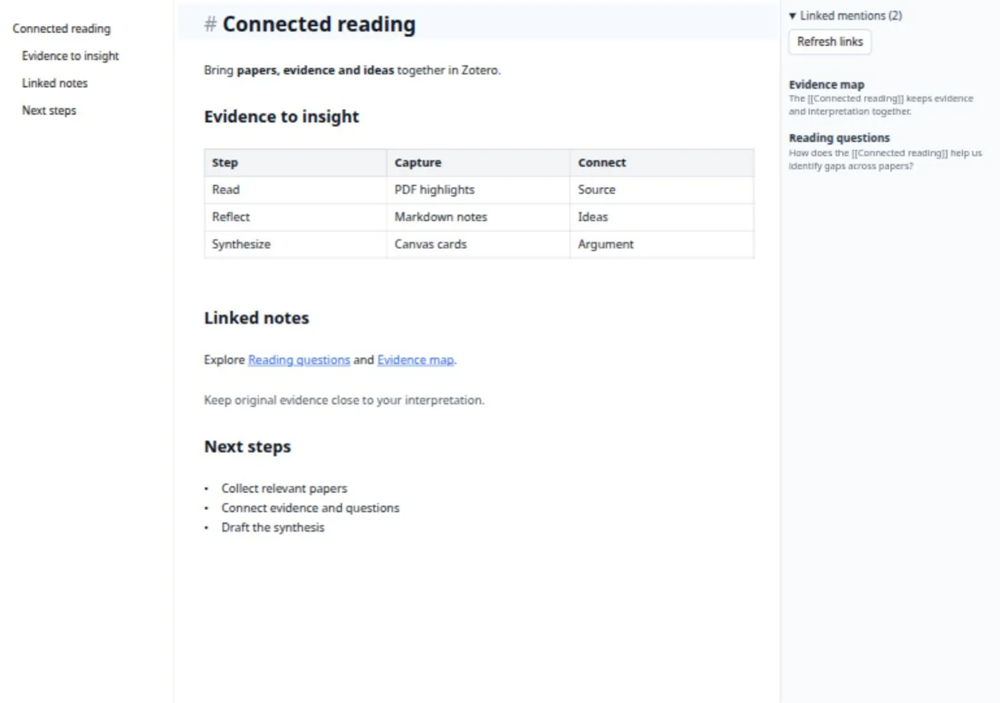
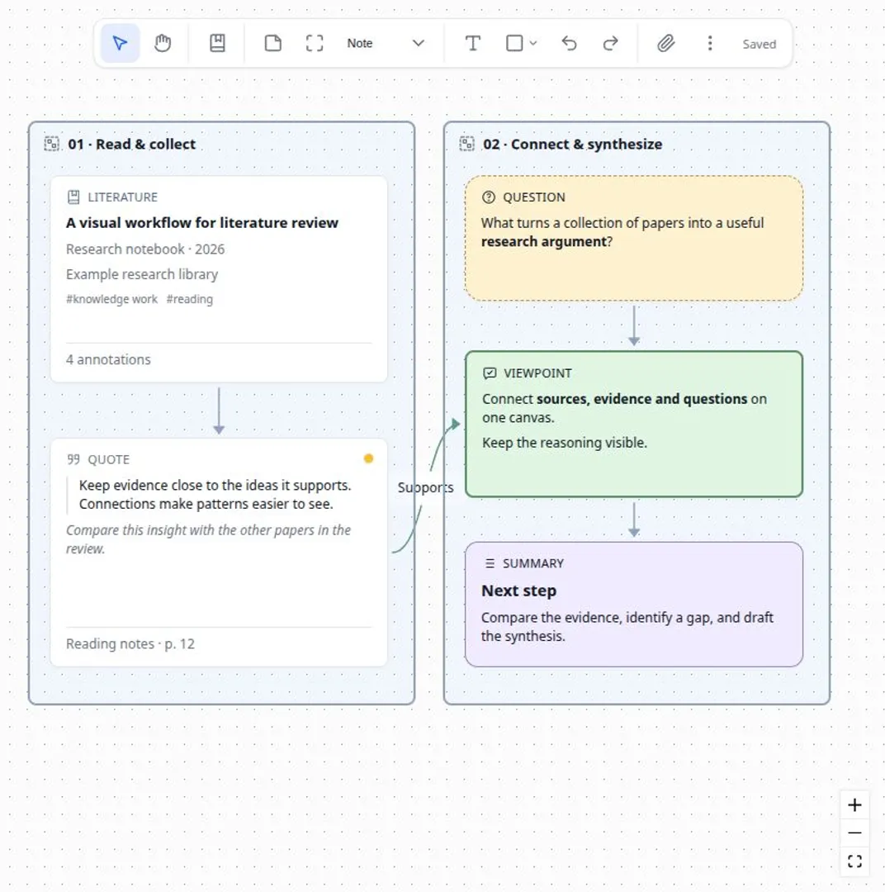

# Scholar Sketch

Scholar Sketch 是 Zotero 的 Markdown 笔记与可视化白板插件。你可以一边阅读文献，一边撰写 Markdown 笔记，再把文献、批注和想法放到白板上，通过分组与连线整理思路。

- 项目主页：[Scholar Sketch](https://github.com/l0o0/scholar-sketch)
- 下载安装：[最新版本](https://github.com/l0o0/scholar-sketch/releases/latest)
- 问题反馈：[GitHub Issues](https://github.com/l0o0/scholar-sketch/issues)

## 安装插件

当前版本支持 Zotero 9、10 和 11 桌面版。

1. 从最新版本页面下载扩展名为 `.xpi` 的安装包。
2. 在 Zotero 中打开「工具 → 插件」。
3. 点击齿轮按钮，选择「从文件安装插件…」，然后选择下载的 `.xpi` 文件。

安装后，Zotero 文库上方的工具栏会出现 Scholar Sketch 按钮。把鼠标停在按钮上，可以看到「Scholar Sketch：新建 Markdown 笔记或白板」提示。

## 先试用一篇笔记和一块白板

### 创建 Markdown 笔记

1. 在 Zotero 中选择一篇文献。
2. 点击工具栏的 Scholar Sketch 按钮，选择「新建 Markdown 笔记…」。
3. 在打开的编辑器中输入标题和正文。

选中一篇文献时，新笔记会成为该文献的附件。没有选中文献时，会在当前文库或分类下创建独立的 Markdown 附件。

Markdown 笔记以 `.md` 文件保存，与 Zotero 自带的富文本笔记是两种不同的内容。以后双击这个 `.md` 附件，就可以继续编辑；也可以在条目右侧的 Markdown 区域中编辑，并通过其菜单切换到标签页或独立窗口。



### 创建白板

点击同一个 Scholar Sketch 按钮，选择「新建白板…」。白板以 `.canvas` 附件保存。选中文献时创建其附属白板，没有选中文献时在当前文库或分类下创建。

想先了解白板的操作方式，可以选择「帮助 → Scholar Sketch：创建示例白板」，按示例中的提示练习添加文献、写卡片和连线。



## 在 Markdown 中快速链接文献和笔记

### 用双左方括号查找 Zotero 中的内容

无需先复制条目链接。在 Markdown 正文中输入两个左方括号 `[[`，再输入标题关键词，就会出现候选列表。

例如，输入 `[[知识管理`，可以查找标题中包含「知识管理」的文献、笔记或附件。候选列表显示 Zotero 条目类型图标、标题、类型和可用的第一作者信息。笔记或附件的作者信息来自其父文献。

列表顶部有四个筛选项：

| 筛选项    | 查找范围                                           |
| --------- | -------------------------------------------------- |
| 全部      | 当前文库中的常规条目、笔记和附件                   |
| 常规条目  | 期刊文章、图书、学位论文等文献元数据条目           |
| 笔记/附件 | Zotero 笔记、Markdown 笔记、白板、PDF 等附件       |
| 已打开    | 当前 Zotero 窗口所有已打开标签页中的附件及其父条目 |

「已打开」适合在阅读多篇 PDF 时快速插入当前阅读材料的链接；它不限于当前激活的一个标签页。

候选列表打开后，可以直接用键盘操作：

| 按键          | 操作                   |
| ------------- | ---------------------- |
| `Tab`         | 切换到下一个筛选项     |
| `Shift + Tab` | 切换到上一个筛选项     |
| `↑` / `↓`     | 选择上一条或下一条候选 |
| `Enter`       | 插入选中的链接         |
| `Esc`         | 关闭候选列表           |

切换筛选项后可以继续输入关键词，不需要重新点击正文。使用中文输入法时，请先完成候选词的确认，再操作链接候选列表。

这里插入的是**可跳转的文献或笔记链接**，用于把阅读材料和想法联系起来。它不会自动生成 GB/T 7714、APA 等格式的正式引文，也不会自动生成参考文献表。

### 打开已经插入的链接

- 编辑时，按住 `Ctrl`（macOS 为 `Cmd`）并点击链接。
- 在只读预览中，直接点击链接。

文献链接会交给 Zotero 打开；Markdown 笔记和白板链接会打开对应文档。

### 链接到笔记的某个标题

在 `[[` 后输入笔记名，再输入 `#`，可以继续选择笔记中的标题。例如：

```markdown
[[阅读笔记#研究方法|查看研究方法]]
[[#下一步|跳到本文的下一步]]
```

竖线 `|` 后是显示文字。由候选列表插入的 Markdown 笔记链接通常还会带有附件标识，便于区分同名笔记；日常使用时直接从候选列表选择即可。

## 选择适合当前任务的编辑模式

编辑器提供三种模式，可以通过工具栏或「更多 → 模式」切换。

| 模式           | 适合的操作                                             |
| -------------- | ------------------------------------------------------ |
| Live／实时预览 | 一边输入一边查看标题、表格、图片、公式和图表的显示效果 |
| 源码           | 查看和修改完整 Markdown 标记，排查格式问题             |
| 只读预览       | 连续阅读整篇笔记，直接点击链接和脚注                   |

实时预览中，正在编辑的内容会显示必要的 Markdown 标记；光标移开后恢复显示效果。工具栏宽度较小时，部分操作会收进「标题」「文本格式」「插入」等菜单中。

常用默认快捷键包括：

| 按键                   | 操作                   |
| ---------------------- | ---------------------- |
| `Ctrl/Cmd + S`         | 保存                   |
| `Ctrl/Cmd + Z`         | 撤销                   |
| `Ctrl/Cmd + Shift + Z` | 重做                   |
| `Ctrl/Cmd + B`         | 粗体                   |
| `Ctrl/Cmd + I`         | 斜体                   |
| `Ctrl/Cmd + K`         | 插入普通 Markdown 链接 |
| `Ctrl/Cmd + F`         | 查找与替换             |

更多快捷键及可调整的快捷键，请查看「更多 → 快捷键」和设置中的「快捷键」页面。

## 用表格、图片、公式和流程图整理内容

### 编辑表格

点击工具栏的「插入表格」，或者直接输入 Markdown 表格。实时预览中可以点击单元格修改内容。

- `Tab` 切换到下一个单元格，`Shift + Tab` 切换到上一个单元格。
- 在最后一个单元格按 `Tab`，可以继续添加一行。
- 表格边缘的添加按钮可以新增行或列。
- 在表格中右键，可以插入、移动或删除行列，也可以调整列的对齐方式。
- 通过行列操作柄可以选择整行或整列，并拖动调整顺序。

**删除刚新增的一行**：在这一行的单元格上右键，选择「删除行」。如果已经选中整行或整列，使用对应的「删除选中的行」或「删除选中的列」。「清空选中的单元格」只清除内容，不删除表格结构。

### 插入和管理图片

可以使用工具栏的「插入图片」，也可以粘贴剪贴板中的图片或把图片文件拖入编辑区。支持插入 PNG、JPEG、GIF 和 WebP，单张图片不超过 15 MB。

选中图片后可以调整显示宽度或查看原图。图片文件会保存在 Markdown 存储附件的资源目录中，正文中使用相对路径引用。

「更多」菜单还提供：

- **导入外链图片**：把笔记中可读取的外部图片保存到附件中，便于离线阅读。
- **清理未引用图片**：清理当前笔记已不再引用的图片资源。清理前请确认不再需要这些图片。

插入图片需要当前 Markdown 是可写的 Zotero 存储附件。链接文件附件不支持这一图片写入方式；可以先通过 Scholar Sketch 的「导入 Markdown…」创建存储附件。

### 输入公式和脚注

使用 `$...$` 编写行内公式，使用 `$$...$$` 编写独立公式。例如：

```markdown
能量关系为 $E = mc^2$。

$$
\sum_{i=1}^{n} x_i
$$

这是一条需要补充说明的结论。[^说明]

[^说明]: 在这里填写脚注内容。
```

公式也支持 `math` 围栏代码块。只读预览和 HTML/PDF 导出会显示排版后的公式，脚注支持跳转和返回。

### 用 Mermaid 绘制流程图

在笔记中输入语言标记为 `mermaid` 的代码块，即可描述流程图、时序图或思维导图。例如：

````markdown

````

在实时预览中，把光标移出代码块即可看到图形，点击图形可以继续编辑源码。只读预览和 HTML/PDF 导出也会保留图形。

图表支持浅色与深色主题，渲染功能随插件提供，无需联网。如果语法有误或图表过于复杂，编辑器会保留源码并显示提示，可以返回源码修改。

## 在长笔记和多篇笔记之间导航

### 使用目录跳转

编辑器左侧目录根据正文中的标题生成。点击标题即可跳到对应位置。没有目录时，可以先用 `#`、`##`、`###` 添加不同层级的标题。

工具栏的左右侧栏按钮分别控制目录和引用侧栏。窗口较窄时，可以先收起侧栏，把更多空间留给正文。

### 查看谁引用了当前笔记

右侧「引用此笔记」面板会列出当前文库中链接到这篇 Markdown 笔记的其他 Markdown 笔记，并显示引用片段。点击结果可以返回引用位置。

反向链接根据**已保存的笔记**建立。刚在另一篇笔记中添加链接时，先完成保存，再查看或点击「刷新链接」。

如果看到「部分笔记暂未纳入索引，结果尚不完整」，点击提示可以查看未纳入结果的笔记及原因，例如附件尚未下载或读取异常。先在 Zotero 中下载或恢复相应附件，再刷新链接。这条提示本身不表示当前笔记损坏。

### 搜索整个文库的 Markdown 笔记

选择「更多 → 搜索文库笔记…」，输入关键词，可以搜索当前文库中已保存 Markdown 笔记的标题、文件名和正文。点击结果会打开笔记并定位正文命中位置。

多个关键词需要同时匹配，最多显示 100 篇结果。尚未下载、读取失败或还未保存的内容可能不会出现在结果中。只想查找当前文档时，使用 `Ctrl/Cmd + F`。

## 从 PDF 批注生成笔记

1. 在 Zotero 文库中选中文献条目或 PDF 附件。
2. 右键打开 Scholar Sketch 菜单，选择「从 PDF 批注生成 Markdown…」。
3. 勾选需要整理的批注，点击「生成 Markdown 笔记」。

生成的笔记包括文字摘录、评论、页码和返回原 PDF 批注的链接。纯图片或区域截图没有文字和评论时，不会列入这项文字批注导出。

## 导入、导出和迁移 Markdown 笔记

### 导入已有 Markdown 文件

点击 Zotero 工具栏的 Scholar Sketch 按钮，选择「导入 Markdown…」。选中文献后导入，会把笔记放在该文献下；未选中文献时，导入到当前文库或分类。

导入会复制 Markdown 正文及其引用的受支持本地图片，创建新的 Zotero 存储附件。原文件不会变成与 Zotero 自动双向同步的外部笔记。

### 选择合适的导出方式

| 需要完成的任务                                         | 入口与结果                                                                               |
| ------------------------------------------------------ | ---------------------------------------------------------------------------------------- |
| 分享当前笔记的阅读效果                                 | 编辑器「更多 → 导出 → HTML」                                                             |
| 把当前笔记保存为 PDF                                   | 编辑器「更多 → 导出 → PDF」，在打印对话框中选择保存为 PDF                                |
| 只导出文库中选中的 Markdown 笔记                       | 选中一个或多个 `.md` 附件，使用 Scholar Sketch 工具栏或右键菜单中的「导出选择 MD 文件…」 |
| 把当前文库的 Markdown 笔记整体带到 Obsidian            | 编辑器「更多 → 导出 → Obsidian…」                                                        |
| 把当前文库的 Markdown 笔记整体导出为普通 Markdown 链接 | 编辑器「更多 → 导出 → Markdown…」                                                        |

最后两项的范围是**当前文库的 Markdown 笔记**，不是当前打开的一篇。导出时会在所选目录下新建子目录，并处理笔记之间的链接及受支持的本地图片。遇到缺失图片、无法解析的链接等情况，请查看导出目录中的 `REPORT.md`。

Obsidian 导出保留 Wiki 链接形式，普通 Markdown 导出使用标准 Markdown 链接。文献、PDF 等 Zotero 来源链接仍需要对应的 Zotero 条目可访问。远程图片默认保留其网址；需要离线使用时，可先导入外链图片。

这是一项导出功能，不是 Zotero 与 Obsidian 的实时双向同步。若之后在两边继续编辑，应自行决定保留哪个版本，再导入或迁移。

## 用白板连接文献、批注和想法

### 添加文献和 PDF 批注

- 点击白板顶部的「添加 Zotero 资料」，从选择窗口中添加条目。
- 或者从 Zotero 文库把文献条目拖到画布上。
- 对文献卡片使用「查看批注」，可以搜索、筛选和选择其批注，再添加为引文卡片。
- 对来源卡片使用「打开来源」，可以返回 Zotero 中的对应内容；对批注来源可以返回原 PDF 的批注位置。

白板保存文献来源的引用和展示信息。删除白板上的来源卡片，不会删除 Zotero 中的原文献。来源信息变化后，可以通过「刷新来源」更新卡片。

### 写问题、观点和证据卡片

打开顶部的「笔记」菜单，选择笔记、问题、观点、证据或总结，再点击画布放置卡片。可以按下面的思路组织阅读：

1. 用「问题」写出想弄清楚的事情。
2. 加入相关文献和批注，作为材料。
3. 用「观点」写出自己的理解。
4. 用「证据」记录支持或反驳观点的材料。
5. 用「总结」归纳共识、分歧和下一步。

双击正文或使用「编辑正文」修改卡片内容。卡片正文支持 Markdown 的标题、强调、列表、代码、链接、公式和脚注。编辑正文时，`Ctrl/Cmd + Enter` 提交，`Esc` 取消本次编辑。

标题可以留空。选中卡片后可以切换类型，也可以保存、套用和管理自定义模板。来自 Zotero 笔记的卡片可使用「从 Zotero 刷新」；如果卡片已经有本地修改，刷新替换前会要求确认。

### 添加图片、文件和形状

顶部「文件」和画布空白处右键菜单支持选择本地文件，也可以拖入系统文件或粘贴剪贴板截图。图片可以放大查看，文本文件可显示摘要，其他附件按类型显示相关信息。

本地导入文件嵌入 `.canvas` 文档，单个文件最多 15 MB，每批最多 30 MB。引用的 Zotero 附件仍使用来源引用，不会再复制一份原件；未下载的 Zotero 附件不会仅为了预览就自动下载。

「形状与绘图」中可以添加矩形、圆角矩形、菱形、椭圆、线条、箭头和文字。双击相应内容可以编辑文字；选中后可以调整填充、描边和文字样式。

矩形、菱形和椭圆中的字号默认根据框的大小和文字内容自动调整。手动指定字号后使用固定字号；在字号选项中选择「自动」可以恢复自动调整。较长的段落更适合放在笔记卡片中。

### 连线和分组

从卡片的连接点拖到另一张卡片，可以建立连线。选中连线后可以编辑文字、颜色、线型、箭头，并选择「相关」「支持」「反驳」等关系。

多选卡片后使用「将所选卡片组成分组」，可以把一组材料一起移动和整理。也可以将卡片加入已有分组、移出分组或取消分组。

拖动卡片时，辅助线会帮助对齐边缘、中心和间距。按住 `Alt` 拖动可暂时关闭吸附。多选后还可以使用对齐、等距分布等操作。

「更多 → 自动布局」会整理当前选区；未选择卡片时，会先询问是否整理整张白板。布局结果可以撤销。

### 用格式刷统一样式

1. 选中作为样式来源的卡片或形状。
2. 点击「格式刷」。
3. 点击目标卡片或形状，应用样式。

双击格式刷可以连续使用，按 `Esc` 退出。右键菜单也有「复制样式」和「粘贴样式」，可以向多个选中对象批量粘贴。

格式刷复制兼容的外观属性，不复制文字内容、文献引用、位置或尺寸。同类对象以及不同面积形状之间可以复用文字样式；不同类别的卡片之间主要复用填充、描边等外观。直线、箭头和卡片之间的连线不使用这一卡片格式刷。

### 移动画布、查找和复用卡片

| 按键或操作                         | 用途                             |
| ---------------------------------- | -------------------------------- |
| 按住空格拖动，或切换到抓手工具 `H` | 平移画布                         |
| `V`                                | 返回选择工具                     |
| `Shift + 1`                        | 适应整张画布                     |
| `Shift + 2`                        | 聚焦所选内容                     |
| 方向键                             | 微移选中内容                     |
| `Shift + 方向键`                   | 以较大步长移动选中内容           |
| `Ctrl/Cmd + F`                     | 搜索白板中的标题和正文           |
| 搜索时 `Enter` / `Shift + Enter`   | 定位下一条／上一条结果           |
| `Ctrl/Cmd + C`、`Ctrl/Cmd + V`     | 复制选区并粘贴，也可以跨白板粘贴 |
| `Delete`                           | 删除选中内容                     |
| `Ctrl/Cmd + Z`                     | 撤销                             |

复制分组时会保留组内节点、样式和内部连线。跨白板复制仍保留 Zotero 来源引用，不会复制原始 PDF，也不会自动搬运 Markdown 文本中引用的相对路径图片。正在输入文字时，复制、粘贴等按键仍用于文字编辑。

### 导出白板

白板提供 PNG、SVG 和 Markdown 导出。

- **PNG**：适合分享完整画面；默认导出 2 倍图像，画布空白处右键可选择 1 倍、2 倍或 4 倍。大白板导出失败时可尝试较低分辨率。
- **SVG**：适合保留矢量图形；卡片文字采用 SVG 导出布局，与网页中 Markdown 正文的排版可能不同。
- **Markdown**：适合把卡片文字和关系整理成可继续编辑的文本。

需要继续编辑布局时，应保留原始 `.canvas` 文件。白板使用 JSON Canvas 格式并包含 Scholar Sketch 扩展数据，其他软件不一定支持全部卡片、来源信息和内嵌文件。

## 保存、同步和恢复误改的内容

### 确认当前内容已经保存

Markdown 和白板支持自动保存，也可以手动保存。编辑结束后，留意「已保存」或自动保存状态；看到「保存失败」时，应先处理提示，避免直接关闭。

在另一台电脑继续工作前，建议先让当前电脑保存并完成 Zotero 同步，再在另一台电脑完成同步后打开文档。不要在两台设备或两个外部编辑器中同时修改同一个文件。

### 区分 Zotero 存储附件和链接文件

- **存储附件**：由 Zotero 管理文件。启用并正确配置 Zotero 文件同步后，可随其同步；Markdown 中由插件保存的图片也属于附件资源。
- **链接文件附件**：文件仍位于原路径，不通过 Zotero 文件同步。需要自行维护文件及图片资源的同步。

同步期间，插件会协调本地写入；遇到待下载版本、未解决的同步冲突或编辑器外的文件修改时，会暂停覆盖并提示处理。先在 Zotero 中完成同步、解决冲突，再重新打开文档。如果当前草稿需要保留，可以先从本地历史另存恢复副本。

自动保存不等于多设备同时编辑合并。Zotero 同步冲突需要根据实际内容选择或手动合并，不能固定选择「本地」或「远程」来解决所有情况。

### 从本地历史恢复

Markdown 编辑器中选择「更多 → 本地历史…」，或者在 Zotero 中右键 Markdown／Canvas 附件，选择「本地历史…」。

在历史窗口中选择版本、预览内容，再点击「另存恢复副本…」。恢复副本使用新文件名，不覆盖当前文件；可以将其重新导入 Zotero 后检查和整理。

本地历史保存的是当前设备上的保存前版本、同步期间保留的草稿和冲突草稿，不会通过 Zotero 同步。历史包含 Markdown 正文或 Canvas 内容，但不备份单独引用的图片、PDF 等资源，因此不能代替完整备份。

## 调整外观和快捷键

在 Markdown 编辑器中打开「更多 → 设置」，或在 Zotero 设置中选择「Scholar Sketch」，再点击打开设置的按钮。

设置中可以调整 Markdown 的字体、字号、背景颜色，选择跟随系统、浅色或深色外观；还可以设置新建笔记的 YAML frontmatter、白板配色方案以及快捷键。关于页面可以查看插件版本和构建信息。

## 查阅帮助和了解新功能

在 Zotero 设置中选择「Scholar Sketch」，可以点击「使用指南」查阅本文，或点击「本次更新」查看当前版本的功能介绍。Markdown 编辑器设置的「常规」页面也提供「使用指南」入口。

更新到新版本后，首次成功打开并显示 Markdown 笔记或白板时，会自动展示一次新功能提示。提示不会抢走编辑焦点，也不会阻止继续操作；关闭后，该版本不会在每次打开文档时反复提示。以后仍可从 Zotero 设置中的「本次更新」重新查看。

## 常见问题

### 双击 Markdown 附件没有打开 Scholar Sketch

先在 Scholar Sketch 设置中确认「使用 Markdown 编辑器打开 .md 附件」已开启，再确认附件已下载、可以在本机读取。需要创建笔记时，请使用 Zotero 工具栏的 Scholar Sketch 按钮。

### 输入双左方括号后没有找到目标

先尝试输入标题的一部分，再检查筛选项和所在文库。「常规条目」不会列出笔记或附件；「已打开」只列出当前 Zotero 窗口已打开的标签页相关条目。通常按标题检索，作者信息用于辨认候选，不等于作者检索入口。

### 点击编辑器中的链接没有跳转

编辑状态下请使用 `Ctrl/Cmd + 点击`，或者切换到只读预览后直接点击。如果链接指向的附件尚未下载、来源已被删除或标题已不存在，先检查对应目标。

### 另一台电脑能打开 Markdown，但图片不见了

先检查该 Markdown 是否为 Zotero 存储附件，并确认 Zotero 文件同步已完成。远程图片还需要可访问的网络；绝对路径或链接文件中的本地图片不会自动随笔记同步。

如果状态显示图片缺失或尚未同步，请检查来源电脑上的原图及附件资源，保留现有文档和本地历史，再处理同步问题。反馈时附上插件版本、Zotero 版本、操作系统、使用的同步方式和复现步骤；无需提供整份私人文库。

### 能否把这些链接直接作为论文参考文献

`[[` 插入的链接用于阅读跳转和知识关联。需要正式引文与参考文献表时，应使用 Zotero 的引文排版功能及相应写作软件集成。
